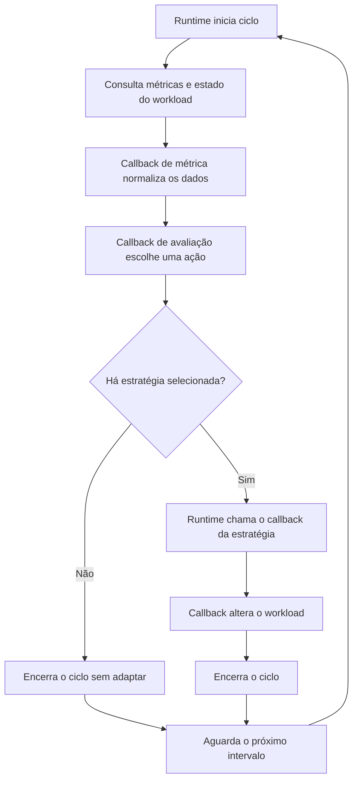
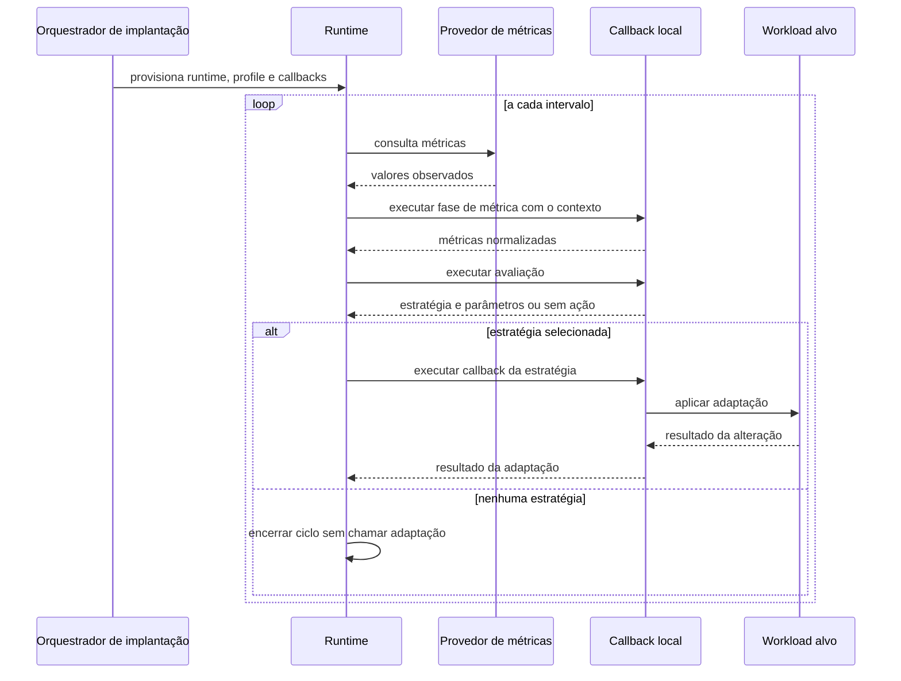
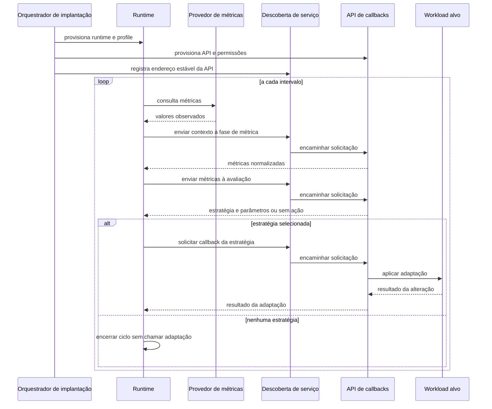

# Arquitetura das implementações CSA: callbacks locais e HTTP

Este documento compara os dois formatos de execução do CSA usados no projeto. Os fluxos são descritos por responsabilidades e contratos, sem depender de uma linguagem, biblioteca ou ferramenta específica.

## Componentes comuns

- **Orquestrador de implantação:** cria os processos necessários, entrega configuração e permissões e mantém os recursos declarados.
- **Runtime:** lê o profile, consulta as métricas e o estado do workload, coordena cada ciclo e escolhe qual callback executar.
- **Callbacks:** implementam as fases de métrica, avaliação e adaptação.
- **Provedor de métricas:** fornece os valores observados para o workload.
- **Workload alvo:** recebe as alterações de réplicas, CPU, imagem ou outros recursos suportados.
- **Profile:** define intervalo, fonte de métricas, limites, estratégias habilitadas e como chamar cada callback.

O runtime coordena o ciclo de autoscaling. O orquestrador de implantação prepara os processos e as permissões; ele não toma a decisão de adaptação a cada ciclo.

## Ciclo lógico compartilhado

Nas duas arquiteturas, o runtime executa o mesmo fluxo:

1. Aguarda o intervalo definido no profile.
2. Consulta as métricas e o estado atual do workload.
3. Chama o callback de métrica para normalizar os dados no contrato esperado pela avaliação.
4. Chama a avaliação, que retorna uma estratégia e seus parâmetros ou indica que nenhuma adaptação deve ocorrer.
5. Se houver estratégia, chama somente o callback correspondente.
6. Aguarda a próxima execução.

## Callbacks locais por scripts

O runtime e os callbacks locais ficam disponíveis na mesma unidade de execução. O profile aponta para cada comando. O runtime inicia o callback escolhido, entrega o contexto do ciclo e recebe seu resultado pelo contrato local de entrada e saída.

Neste formato, o profile, o runtime e os callbacks são implantados juntos. Por isso, um único recurso de implantação pode criar o processo que executa o ciclo e as rotinas chamadas por ele. Os callbacks não precisam de um endpoint de rede para se comunicar com o runtime.

## Callbacks por HTTP

O runtime e os callbacks HTTP ficam em unidades de execução separadas. O runtime mantém o ciclo e envia cada fase para o serviço da API de callbacks. A API recebe o contexto, executa a regra daquela fase e devolve o resultado. Na adaptação, a própria API aplica a alteração no workload com as permissões que lhe foram concedidas.

Como runtime e API são componentes separados, cada um tem ciclo de implantação, saúde e permissões próprios. O runtime precisa consultar as métricas e alcançar a API. A API precisa alcançar o workload para executar as adaptações. Um endereço estável de serviço permite que o runtime encontre a API sem depender do endereço de um processo específico.

No modelo atual do projeto, o orquestrador cria os dois Pods a partir de recursos CSA separados, e um Service direciona as chamadas para o Pod da API. O segundo recurso, com sufixo `runtime`, representa o runtime genérico. Ele existe porque a API e o runtime foram separados em Pods; não representa um callback adicional. Nas versões com scripts, runtime e callbacks compartilham a mesma unidade de execução.

## Comparação

| Aspecto | Callbacks locais por scripts | Callbacks por HTTP |
| --- | --- | --- |
| Responsável pelo ciclo | Runtime | Runtime |
| Chamada dos callbacks | Execução local conforme o profile | Requisição de rede para a API |
| Unidades implantadas | Runtime e callbacks juntos | Runtime e API separados |
| Comunicação | Contrato local de entrada e saída | Contrato de requisição e resposta |
| Local da regra de adaptação | Callback local | API de callbacks |
| Descoberta e disponibilidade | Não exige endpoint para callbacks | Exige endereço de serviço e API disponível |
| Permissões sobre o workload | Compartilhadas na unidade de execução | Concedidas ao componente que executa a adaptação |
| Falhas adicionais | Falha ao iniciar ou executar callback | Falha de conexão, timeout, roteamento ou resposta HTTP |
| Ciclo de atualização | Runtime e callbacks atualizados juntos | API pode ser atualizada independentemente do runtime |

## Contratos que precisam permanecer iguais

A separação do processo não deve mudar o comportamento do autoscaler. As duas formas precisam preservar:

- as mesmas métricas e a mesma normalização;
- os mesmos limites, prioridades e estratégias habilitadas;
- os mesmos parâmetros de entrada e resultado lógico da avaliação;
- as mesmas alterações no workload para cada estratégia;
- os mesmos limites e condições de parada, como rollout em andamento;
- a mesma semântica de sucesso, erro e ausência de adaptação.

Quando nenhuma estratégia é selecionada, o runtime deve encerrar o ciclo com sucesso e não chamar callback de adaptação. A inspeção do runtime comum no projeto mostrou que resultados sem conteúdo, tanto de callbacks locais como de callbacks HTTP, ainda podem ser tratados como erro de parse. Portanto, esse comportamento é uma pendência do contrato entre o runtime e os callbacks, não uma diferença exclusiva de transporte.

## Efeito esperado em desempenho e operação

O formato local evita o salto de rede e a inicialização de uma requisição HTTP, mas mantém runtime e callbacks no mesmo ciclo e unidade de implantação. O formato HTTP adiciona comunicação de rede, serialização e dependências de disponibilidade; também permite manter e escalar a API separadamente.

Essas diferenças descrevem custos e opções operacionais, não uma conclusão sobre qual formato é mais rápido. A comparação de desempenho precisa usar o mesmo workload, profile, métricas e critérios de adaptação, medindo o ciclo completo e a latência de cada fase.

## Escopo da documentação

Esta documentação registra os fluxos arquiteturais e suas diferenças de implantação. Não introduz comportamento novo nem altera runtime, operador, profiles ou scripts de carga.
